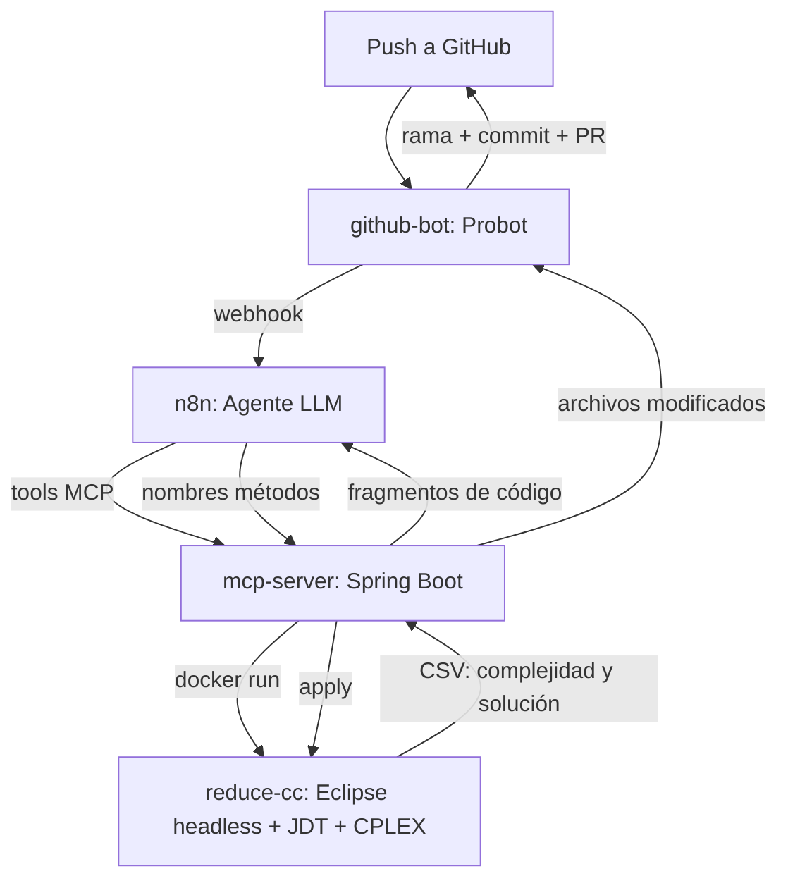

# Reducción de complejidad cognitiva con LLMs + MCP

TFG: agente basado en un LLM, conectado vía protocolo MCP a un servidor
especializado, que asiste en la refactorización de código Java para
reducir su complejidad cognitiva.

## Cómo encajan las piezas

## Componentes

| Carpeta | Qué es | Detalle |
|---|---|---|
| `plugin/`, `product/`, `target-platform/`, `docker/`, `cplex-linux/` | El motor: analiza complejidad cognitiva mediante programación lineal entera (ILP, con CPLEX) y aplica extracciones sobre el código, dentro de un contenedor con Eclipse. | [README-DOCKER.md](README-DOCKER.md) |
| `mcp-server/` | Servidor MCP en Spring Boot. Expone `clone_project`, `prepare_project`, `analyze_project`, `apply_names`, `list_modified_files`, `get_file_content` a cualquier cliente/agente LLM. | [mcp-server/](mcp-server/) |
| `github-bot/` | GitHub App (Probot) que inicia el pipeline ante cada `push` y abre la Pull Request con el resultado. | [github-bot/README.md](github-bot/README.md) |

n8n (no versionado en este repo, se ejecuta como contenedor aparte) aloja
el agente LLM y hace de puente entre `github-bot` y `mcp-server`.