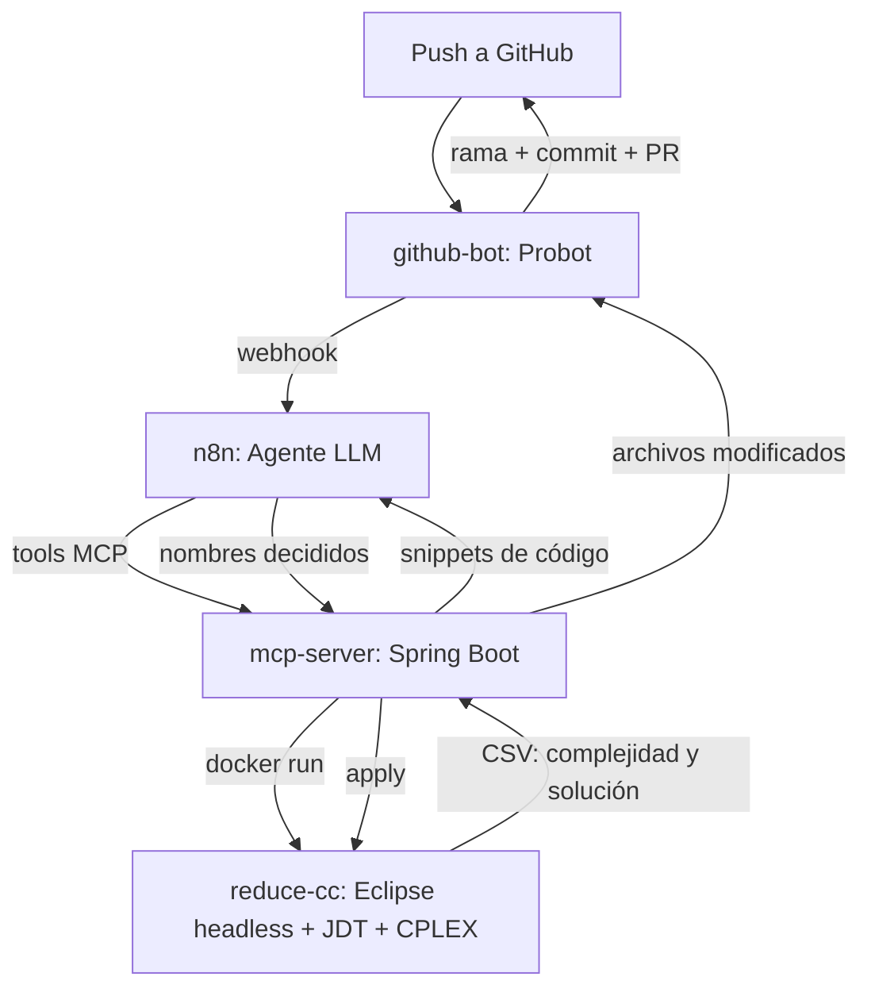

# Reducción de complejidad cognitiva con LLMs + MCP

TFG: agente basado en un LLM, conectado vía protocolo MCP a un servidor
especializado, que asiste en la refactorización de código Java para
reducir su complejidad cognitiva.

## Cómo encajan las piezas

## Componentes

| Carpeta | Qué es | Detalle |
|---|---|---|
| `plugin/`, `product/`, `target-platform/`, `docker/`, `cplex-linux/` | El motor: analiza complejidad cognitiva (ILP/heurísticos) y aplica extracciones reales sobre el código, dentro de un contenedor con Eclipse headless. | [README-DOCKER.md](README-DOCKER.md) |
| `mcp-server/` | Servidor MCP en Spring Boot. Expone `clone_project`, `prepare_project`, `analyze_project`, `apply_names`, `list_modified_files`, `get_file_content` a cualquier cliente/agente LLM. | [mcp-server/](mcp-server/) |
| `github-bot/` | GitHub App (Probot) que dispara el pipeline ante cada `push` y abre la Pull Request con el resultado, con aprobación manual u automática según preferencia (human-in-the-loop). | [github-bot/README.md](github-bot/README.md) |

n8n (no versionado en este repo, se ejecuta como contenedor aparte) aloja
el agente LLM y hace de puente entre `github-bot` y `mcp-server`.

## Estado conocido / limitaciones

- Los solvers heurísticos (`ES-LSF`, `ES-SSF`) tienen un bug documentado
  en el propio motor original — usar `ILP` (ver sección 4 de
  [README-DOCKER.md](README-DOCKER.md)).
- `prepare_project` genera `.classpath` para Maven; Gradle se detecta pero
  no se resuelve todavía.
- El bot no tiene test automatizado propio (el de la plantilla de
  `create-probot-app` probaba el comportamiento de ejemplo, ya sustituido,
  y se retiró para no dejar un test que falla probando algo que ya no
  existe).
